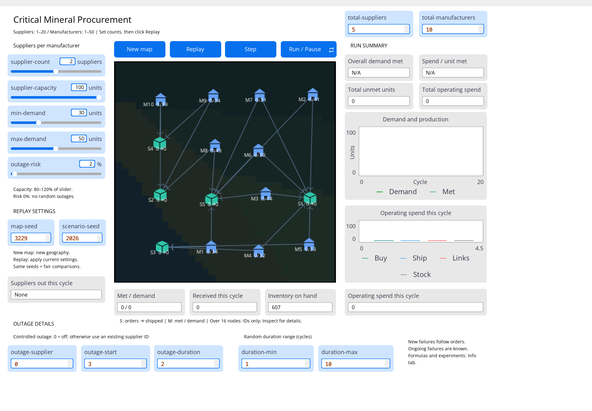

# 关键矿产采购模型：界面与代码学习指南

这份文档用于理解当前 `model.nlogox`，帮助你独立操作模型、解释代码和准备 viva。依据是实际实现，而不是早期 proposal。整理日期：2026 年 10 月 13 日。

**研究问题：**在产能有限、供应商可能暂时断供的情况下，每家制造商固定选择 1、2、3 家供应商，会怎样改变需求满足程度和运营支出？

**先记住一条主线：**制造商先根据需求和库存计算补货量，向已有伙伴下单；供应商可能突然断供，或者因为产能不够按比例交货；制造商用“期初库存＋到货”满足生产需求，最后更新库存和费用。

建议阅读顺序：先读第 1 节熟悉屏幕，再读第 3、5、6、7 节理解程序；最后用第 12 节自测。HTML 版附带当前模型的完整逻辑代码，可以从讲解跳到对应函数。文中 **L 表示 `model.nlogox` 文件行号**；NetLogo 的 Code 选项卡不显示 XML 包装，代码行号比这里小 2。

## 1. 按屏幕位置认识整个界面 {#interface}



截图中：5 家供应商、10 家制造商，每家制造商连接 2 家供应商；地图种子 3229、情景种子 2026。当前读数符合**已经初始化、尚未完成第一个周期**的状态。初始库存总计 607；累计需求和产出仍为 0，所以部分比率显示 `N/A`。这不表示模型坏了。

### 1.1 顶部右侧：网络里有多少实体

| 名称 | 截图值 | 含义与范围 |
|---|---:|---|
| `total-suppliers` | 5 | 整个网络的供应商总数，整数 1–20。 |
| `total-manufacturers` | 10 | 整个网络的制造商总数，整数 1–50。 |

改完数量需要重新初始化。数量变化不会自动调整每家的产能或需求，因此也会改变全网供需比例；实体变多时地图还会扩大，距离和运输费用可能变化。做 1／2／3 家伙伴的公平对照时，应保持这两个数量不变。

### 1.2 地图上方：四个按钮

| 按钮 | 实际调用 | 怎么用 |
|---|---|---|
| **New map** | `setup` → `replay-setup` | 生成一个与当前值不同的 `map-seed`，然后从周期 0 重新开始。改变地理位置，也可能改变初始选商；`scenario-seed` 保持输入框中的值。 |
| **Replay** | `replay-setup` → `initialize-scenario 3` | 根据当前参数和种子重新建立场景。清空旧结果、重置库存和周期，不是接着上次暂停的位置继续。 |
| **Step** | 一次 `go` | 完整执行一个采购／生产周期。初始化后第一次点击处理第 1 周期。适合观察时序和断供。 |
| **Run / Pause** | 反复执行 `go` | 开始或停止连续运行。暂停不会重置结果，再点可以继续。 |

**操作规则：先暂停 → 改参数 → Replay → Step 或 Run。** 模型会检测运行中参数是否改变；改了参数后直接继续会报错，避免把两套条件混进一次结果。错误输入在清空原场景之前就会被拦截。

### 1.3 左侧：五个常用滑块

| 名称 | 截图值 | 它真正改变什么 |
|---|---:|---|
| `supplier-count` | 2 | **每家制造商的合作供应商数**。范围 1–3，不能超过总供应商数。截图是 10 家制造商各有 2 条合同，总共 20 条合同；供应商总数仍是 5。 |
| `supplier-capacity` | 100 | 每家供应商产能的基准。实际产能初始化为滑块值的 80%–120%，所以基准 100 对应各家 80–120。滑块范围 0–100，拖动步长 10。 |
| `min-demand` | 30 | 每家制造商固定周期需求的抽样下限。滑块范围 0–100，拖动步长 10。 |
| `max-demand` | 50 | 上述抽样上限，必须不小于下限。每家在初始化时从 **30、31、…、50** 中抽一次，之后每周期保持这个需求。不是每周期重新抽，也不是全网总需求。 |
| `outage-risk` | 2% | 当期可以发生新随机故障的正常供应商，在下单之后发生故障的概率。范围 0–100%，步长 1。2% 不等于任意时刻只有 2% 的供应商停工，因为每次故障可能持续多周期。 |

`outage-risk = 0` 只关闭**随机**断供。如果底部还指定了可控断供，指定事件仍会发生。所有输入都要求整数；容量与需求滑块的拖动步长为 10，但初始化时的供应商属性和后续分配仍可以产生小数。

### 1.4 左下：种子与停供状态

| 名称 | 截图值 | 用途 |
|---|---:|---|
| `map-seed` | 3229 | 控制节点位置和地图背景，整数 1–9999。地图固定后距离固定。 |
| `scenario-seed` | 2026 | 控制基础价格、产能抽样、需求、初始库存，以及各供应商各周期的潜在故障抽样，整数 1–9999。 |
| **Suppliers out this cycle** | None | 当前周期停供的供应商列表，例如 `S1, S3`。`None` 表示没有；超过五家时用数量概括，红色节点仍标出具体供应商。 |

比较采购策略时，保持其他条件和两个种子不变，只改 `supplier-count` 后点 Replay。每家基础属性和外部故障条件保持可比，但合同、价格、分单和结果可以不同——这些正是策略产生的影响。

### 1.5 中间：地图、节点、标签与连线

| 看到什么 | 表示什么 |
|---|---|
| 方盒子，`S1`、`S2`… | 供应商。青绿色表示正常且订单未超过产能；橙色表示订单超过产能；红色表示断供。 |
| 房子，`M1`、`M2`… | 制造商。一个周期结束后，蓝色表示当期需求全部满足；橙色表示当期有未满足需求。初始化时蓝色只是初始样式，尚无绩效可判断。 |
| `S1 150→100` | 当期收到订单 150，实际发货 100。这里的 150 不是产能。 |
| `M1 35/40` | 当期满足生产需求 35，固定需求 40，缺口为 5。 |
| 连接 M 和 S 的有向线 | 固定合同。代码方向是 **制造商 → 供应商**，可以理解为采购关系或下单方向；不是货物移动的方向。 |
| 较粗的连线 | 同一制造商分给这个伙伴的**计划订单份额**较高。不是按实际交货量画粗细，也不宜跨制造商比较绝对订单量。 |
| 橙色连线 | 实际交付小于订单量。 |
| 红色连线 | 对应供应商正在断供；即使本期因为已知断供而没下单，合同仍会显示红色。 |
| 深色背景区域 | 装饰性地理分区，没有道路、边界阻挡或运输延迟。距离用平面直线距离。 |

超过 16 个实体时只显示 S／M 编号，数量和价格仍可右键 **Inspect** 查看。截图是 15 个实体，因此仍有详细标签。节点的位置固定，模型中的货物和订单主要通过数值变化表示，不会沿着连线播放运输动画。

### 1.6 地图下方：当期流量与库存

| 显示器 | 对应内容 | 怎么读 |
|---|---|---|
| **Met / demand** | `period-fulfilled / period-demand` | 最近完成的一周期，全网满足生产量／总需求量，是数量比，不是百分比。初始化时为 `0 / 0`。 |
| **Received this cycle** | `period-received` | 本周期所有制造商实际收到的矿物总量。 |
| **Inventory on hand** | 全部制造商的 `inventory` 之和 | 当前剩余库存。初始化时是初始库存总量；运行后是刚结束周期的期末库存。 |
| **Operating spend this cycle** | `period-total-cost` | 刚结束周期的采购＋运输＋合同维护＋库存持有费。 |

**到货不等于满足需求。** 有库存时，到货 20 也可能满足 40；补库时，到货 60 可能只满足当期需求 40，其余进入库存。

### 1.7 右上：本次运行的累计表现

| 显示器 | 公式 | 含义 |
|---|---|---|
| **Overall demand met** | 累计满足需求 ÷ 累计需求 × 100% | 从初始化到当前的整体满足率，不是最近一周期的满足率。累计需求为 0 时显示 `N/A`。 |
| **Spend / unit met** | 累计运营支出 ÷ 累计满足需求 | 每单位实际满足生产需求对应的运营支出。没有满足任何需求时为 `N/A`。 |
| **Total unmet units** | 各周期未满足需求的累加 | 已经发生的总缺口。它是历史统计，不是下一周期必须补交的订单。 |
| **Total operating spend** | 各周期四类运营支出的累加 | 本次运行的总支出。低支出也可能只是交付很少，要和满足率一起看。 |

`Spend / unit met` 不是报价、单件采购价或利润。初始库存没有计入购入费，期末库存没有资产抵扣，模型也没有销售收入或缺货罚金。

### 1.8 右侧：两张图

**Demand and production：**横轴为周期，纵轴为全网数量。`Demand` 是每周期总需求，`Met` 是每周期实际满足的生产需求。需求在一次运行中固定，所以运行后需求线通常水平；两条线之间的缺口代表当期未满足量。图中展示的是逐期数值，不是累计曲线。初始横轴 0–20、纵轴 0–100 都会按数据自动扩展。

**Operating spend this cycle：**四根柱子分别是 `Buy` 采购费、`Ship` 运输费、`Links` 合同维护费、`Stock` 库存持有费。每周期先清空再重画，只展示最近一周期。横轴上的 0、4.5 等是排布柱子的坐标，不是时间或费用参数。

### 1.9 最底部：两类断供的设置

| 输入框 | 截图值 | 范围与作用 |
|---|---:|---|
| `outage-supplier` | 0 | 0 表示关闭可控断供；1 表示 S1，以此类推，必须是现有供应商。 |
| `outage-start` | 3 | 可控断供开始周期，整数 1–500。周期 1 是初始化后的第一次 Step。 |
| `outage-duration` | 2 | 可控断供持续周期数，整数 1–20，包含开始的那个周期。 |
| `duration-min` | 1 | 每次随机断供持续时间的抽样下限，整数 1–20。 |
| `duration-max` | 10 | 随机持续时间上限，整数 1–20，不小于下限；抽样包含两端。 |

截图的 `outage-supplier = 0`，所以 `start = 3`、`duration = 2` 暂时不起作用，但风险为 2% 的随机断供仍然开启。为了单独观察定点断供，可设 `outage-risk = 0`、`outage-supplier = 1`、`outage-start = 3`、`outage-duration = 2`，然后 Replay，再逐步 Step。

## 2. 先区分四类数量 {#quantities}

| 数量 | 属于哪里 | 可以与什么不同 |
|---|---|---|
| `order-quantity` | 一个制造商的补货意愿 | 可以大于生产需求，因为还想补库存。 |
| `units-ordered` | 一条合同提交的订单 | 制造商总补货量按份额分到各条合同；无可用伙伴时可能一单都发不出去。 |
| `units-delivered`／`amount-received` | 合同交付量／制造商总到货量 | 因断供或配给而少于订单。 |
| `production-met` | 制造商实际满足的生产需求 | 使用期初库存＋到货，但不能超过本期需求。 |

供应商的 `orders-received` 是收到的**订单**；制造商的 `amount-received` 是收到的**货物**。两个名字都带 received，含义不同。

库存是跨周期保留的状态；订单、到货、当期满足量每周期重算；`cumulative-*` 是历史累计。观察屏幕时，先判断读数属于哪一类。

## 3. 看懂代码所需的 NetLogo 基础 {#netlogo-basics}

当前文件是 NetLogo 7.0.4 的 `.nlogox` 格式。真正的模型逻辑在文件 L3–675 的 `<code>` 段；后面依次有界面、Info 说明、图标形状、预览命令和实验定义。文件中的 wolf、sheep 等图标定义不表示模型模拟了狼或羊。

| 写法 | 在本模型里的意思 |
|---|---|
| `breed [suppliers supplier]` | 定义一类供应商实体；manufacturers 同理。两类实体都属于 NetLogo 的 turtles，不表示它们真的会移动。 |
| `directed-link-breed [contracts contract]` | 定义有方向的采购合同连线。 |
| `globals [...]` | 全局设置、统计量、模型参数。 |
| `suppliers-own [...]` | 每个供应商各自拥有一套这些变量。manufacturers-own 和 contracts-own 同理。 |
| `to ... end` | 执行动作的过程，例如 `go`。 |
| `to-report ... report ... end` | 返回一个结果的过程，例如返回总库存的 `total-inventory`。 |
| `set inventory ...` | 改写当前对象的库存值。 |
| `let available ...` | 创建只在当前局部范围中使用的临时变量。 |
| `ask manufacturers [ ... ]` | 让所有制造商分别执行括号中的操作；此时 `demand` 指当前制造商自己的需求。 |
| `[unit-price] of end2` | 从合同的目标端供应商读取报价。 |
| `with [条件]` | 筛选符合条件的实体或合同集合。 |
| `sum [inventory] of manufacturers` | 先收集每家的库存，再求总和。 |
| `ifelse`／`ifelse-value` | 前者执行两个分支中的一个，后者返回两个值中的一个。 |
| `sort`／`foreach` | 将实体转成确定顺序的列表，再按列表依次处理。初始化抽样使用这种写法稳定属性与 ID 的对应。 |
| `random 41` | 产生 0–40 的整数；所以 `80 + random 41` 得到 80–120，包含上限。 |
| `ticks`／`tick` | 已完成周期数／把它增加 1。 |

**执行上下文是阅读重点。** observer 负责调度；supplier 读写供应商变量；manufacturer 读写制造商变量；contract 读写合同变量。嵌套 `ask eligible [...]` 后，当前对象从制造商切换到合同，因此要用 `[order-quantity] of end1` 读取下单者的订单量。

合同从制造商指向供应商，所以：`end1` 是制造商，`end2` 是供应商；制造商用 `my-out-contracts` 找到自己的采购关系，供应商用 `my-in-contracts` 收集所有客户订单。

普通 `ask` 遍历集合时顺序不固定。本模型先统一下单，再统一汇总与配给，不会因为某个制造商先被执行就先抢走产能。它采用的是同时提交订单之后的比例分配。

## 4. 变量分别记住什么 {#variables}

### 4.1 全局设置和统计

14 个界面输入会复制到内部 `*-setting` 变量：容量、需求上下界、伙伴数、地图种子、指定断供编号／开始／时长、随机风险／时长上下界、情景种子、供应商总数、制造商总数。`read-interface-settings` 通过 `runresult` 读取界面变量。

`settings-snapshot` 把这些值按固定顺序装进列表；`active-settings` 保存本次运行实际使用的列表。每次 `go` 都比较两者。`settings-ready?` 记录内部默认设置是否已准备；`map-columns` 记录地图网格的列数。

| 参数／变量组 | 意义 |
|---|---|
| `transport-cost-per-distance = 3` | 交互运行中的单位距离运输费系数；不是一个截图上的滑块。 |
| `price-response = 0.20` | 利用率对报价的反馈强度。 |
| `relationship-fee = 50` | 每条已建立合同每周期的固定维护费。 |
| `holding-fee-per-unit = 1` | 每单位期末库存每周期的持有费。 |
| `initial-inventory-total` | 本次初始化的全网库存总量，用于核对守恒。 |
| `period-demand/received/fulfilled/unmet` | 最近完成周期的总需求、到货、满足需求、未满足需求。 |
| `cumulative-demand/received/fulfilled/unmet` | 上述数量从初始化开始的累计值。 |
| `period-*-cost` | 当前周期的 purchase、transport、relationship、holding、total 五类费用统计。 |
| `cumulative-*-cost` | 同样五类费用的累计值。 |

### 4.2 每个供应商的状态

| 变量 | 意义 |
|---|---|
| `capacity` | 正常状态每周期最大产能，一次运行中固定。 |
| `available-capacity` | 当期可用产能：正常时等于 capacity，断供时为 0。 |
| `base-price`／`unit-price` | 固定基础价／本周期实际报价。 |
| `orders-received`／`amount-shipped` | 收到的总订单／实际总发货。 |
| `fill-ratio` | 本供应商对所有客户统一采用的交付比例。 |
| `capacity-utilization` | 刚结束周期的实际发货÷正常产能，将影响下一周期价格。 |
| `pricing-utilization` | 生成当前报价时用的历史利用率；Step 后不一定等于刚更新的 capacity-utilization。 |
| `scheduled-outage?`／`random-outage?` | 指定断供／随机断供是否有效。 |
| `random-outage-through` | 随机断供持续到哪个周期，包含该周期；存的是结束周期，不是剩余周期数。 |
| `outage-active?` | 两类断供取逻辑“或”的最终停供状态。 |

### 4.3 每个制造商的状态

| 变量 | 意义 |
|---|---|
| `manufacturer-id` | 面向人的 M1、M2 编号。 |
| `demand` | 每周期固定需求。 |
| `initial-inventory` | 初始化库存，后续保留作记录。 |
| `inventory`／`inventory-at-start` | 当前剩余库存／本周期开始时拍下的库存快照。 |
| `inventory-target` | 希望周期结束后维持的库存目标；交互模型默认等于一周期需求。实际库存不保证达到目标。 |
| `order-quantity`／`unplaced-order` | 希望补货多少／其中因为没有可用伙伴而未能提交的数量。 |
| `amount-received` | 当期各合同到货之和。 |
| `production-met`／`unmet-demand` | 本期实际满足生产需求／本期需求缺口。 |
| `buyer-purchase-cost`／`buyer-transport-cost` | 本期实际交付对应的采购费／运输费。 |
| `buyer-relationship-cost`／`buyer-holding-cost` | 本期合同维护费／期末库存费。 |
| `buyer-total-cost`／`buyer-cumulative-cost` | 本期总支出／此制造商累计支出。 |

### 4.4 每条合同的状态

| 变量 | 意义 |
|---|---|
| `route-distance` | 两个端点的固定直线距离。 |
| `transport-rate` | 每交付一单位矿物的运输费，距离×系数。 |
| `landed-unit-cost` | 当前采购报价＋单位运输费，不包括固定合同费和库存费。 |
| `order-share` | 当前订单分给这条合同的份额。 |
| `units-ordered`／`units-delivered` | 本期订单／本期实际交付。 |
| `purchase-charge`／`transport-charge` | 该合同本期实际采购／运输收费。 |

## 5. 点击 Replay 时发生了什么 {#initialization}

入口：[replay-setup](#src-replay-setup)，L212；初始化主体：[initialize-scenario](#src-initialize-scenario)，L216–237。

1. 把运费系数 3 传给 `initialize-scenario`。
2. 读取并验证所有界面设置；错误值不会先清掉旧模型。
3. 把设置保存到局部列表 `selected-settings`，随后 `clear-all` 清空上次运行。
4. 按实体数量调整地图，恢复内部设置，保存 `active-settings`。
5. 设置维护费 50、持有费 1、运费系数、价格反馈 0.20。
6. `create-network`：创建供应商 → 创建制造商 → 安排位置 → 建立合同 → 更新标签。
7. 清零所有周期／累计统计，记录初始库存总数，再 `reset-ticks`。

**为什么先设运费再选商？** 因为初始伙伴按“基础价格＋距离×运费”排序。若选完伙伴才修改运费，就没有真正模拟该运费条件下的选商行为。

### 5.1 初始化供应商与制造商

`initialize-suppliers`（L255–279）为每家供应商抽取整数基础价 80–120，初始报价等于基础价；产能为 `capacity-setting × (80 + random 41) / 100`。

`initialize-manufacturers`（L281–302）为每家抽取固定需求和 40–80 的初始库存，并设 `inventory-target = demand`。库存目标不是额外赠送的库存；只有初始库存是真正已经持有的数量。

初始化先创建所有供应商，因此供应商内部 `who` 为 0、1、…；图上编号使用 `who + 1`。制造商随后创建，使用 `who - supplier-population + 1` 转成 M1、M2。指定断供编号用图上的 S 编号，不用从零开始的内部编号。

### 5.2 地图如何生成

`configure-map`（L304–316）计算网格边长 `max(4, ceiling(sqrt(实体总数)))`；`generate-map`（L318–334）打乱格子，让每个实体占据一个不同格子，再在每个轴加入 ±0.6 的小偏移。

格距为 7.5，所以相邻格中实体的最小中心间距至少为 6.3。默认 15 个实体使用 4×4 网格、33×33 patches；最大 70 个实体使用 9×9 网格、71×71 patches。显示画面保持约 500×500，但真实模型空间扩大，运距会变化。`paint-regions` 只画背景，不参加供需规则。

### 5.3 怎么选择初始伙伴

`establish-contracts`（L351–364）让每家制造商：

1. 对所有供应商计算 `landed-cost-from`：基础报价＋直线距离×运费。
2. 按该成本从低到高排序；完全同价时选内部编号较小者在前。
3. 取前 `partner-count-setting` 家，建立制造商→供应商的合同。
4. 保存固定运距、单位运费和当前到货单价。

**这是考虑价格和距离的静态选商规则。** 它不预先预测其他制造商会选择谁，也不考虑未来产能拥堵与故障。合同在本次运行内不会替换，后续只能在这些伙伴之间调整订单。这也解释了为什么全网总产能足够仍可能缺货。

## 6. 一个 Step 的完整执行顺序 {#cycle}

核心函数：[go](#src-go)，L400–422。它是整个模型的调度表，最值得优先掌握。

```netlogo
recover-suppliers
update-supplier-prices
place-orders
apply-new-outages
allocate-supply
deliver-orders
record-supplier-results
update-manufacturer-results
update-supplier-display
update-node-labels
update-network-totals
tick
```

进入这些步骤前，程序先检查是否已经初始化、输入是否有效、输入是否与本次运行的设置快照一致。

| 顺序与过程 | 读什么、做什么 | 结果供谁使用 |
|---|---|---|
| 1 `recover-suppliers` | 用 `ticks + 1` 判断旧故障是否结束，刷新已知可用产能。 | 后面的定价和下单。 |
| 2 `update-supplier-prices` | 正常供应商用上一周期实际利用率更新本期价格，合同更新到货单价。 | 制造商决定分单份额；交付时也用这个报价收费。 |
| 3 `place-orders` | 清空合同上周期订单；记录期初库存，算补货量，向已知可用伙伴分单。 | 每家供应商收到的订单。 |
| 4 `apply-new-outages` | 应用本期新开始的指定或随机断供，更新可用产能。 | 供应商当期可能变成零产能。此时订单已发出。 |
| 5 `allocate-supply` | 汇总各客户订单，计算每家供应商统一的交货比例。 | 各合同计算实际交付。 |
| 6 `deliver-orders` | 订单×交货比例得到交付；按实际交付计算采购、运输费。 | 制造商的到货与费用，供应商的实际发货。 |
| 7 `record-supplier-results` | 发货量÷正常产能，记录本期利用率。 | 下一周期的报价。 |
| 8 `update-manufacturer-results` | 期初库存＋到货，满足需求，留下期末库存，算四类费用。 | 网络汇总及节点状态。 |
| 9–10 显示更新 | 供应商颜色、实体标签。 | 屏幕展示。 |
| 11 `update-network-totals` | 汇总制造商当期结果，再累加到历史总量。 | 显示器和图表。 |
| 12 `tick` | 完成周期数加 1；按界面图表定义更新绘图。 | 下一次 go 的时钟与当前画面。 |

记忆顺序：**恢复 → 报价 → 下单 → 新断供 → 配给 → 交付 → 记账 → 汇总。**

不能随意调换“下单”和“新断供”：放在下单之前会让制造商提前知道当天的新故障，改变模型的信息假设。也不能用本周期刚发生的交付来决定同周期下单时已经使用的价格；现在的价格反馈有明确的一周期滞后。

## 7. 七个关键计算与一个手算例子 {#equations}

### 7.1 当前报价

对应 [update-supplier-prices](#src-update-supplier-prices)，L436–444。

```text
本期报价 = 基础价 × (1 + 0.20 × 上期实际产能利用率)
上期利用率 = 上期实际发货量 ÷ 正常产能
```

利用率在 0–1，所以报价最多是基础价的 1.20 倍。每次都从基础价重新算，不复利。基础价 100、上期发货 50／产能 100，本期报价 110；若本期发货 80，下期报价 116，而不是在 110 上继续加价。

第一周期尚无产出历史，利用率为 0。已知断供的供应商保持旧报价；从断供恢复时，前一周期利用率为 0，所以新报价回到基础价。

### 7.2 补货量

对应 [place-orders](#src-place-orders)，L446–470。

```text
Q = max(0, 本期需求 D + 目标库存 T − 期初库存 I)
```

`D + T` 是希望先拥有的数量；之后生产消耗 D，理想情况下还剩 T。默认 `T = D`。需求 40、目标 40、期初库存 60，订单为 20；不是“库存足够生产就一定不采购”。

### 7.3 在已有伙伴之间分单

```text
每单位到货成本 L_j = 当前报价 P_j + 固定单位运费 F_j
权重 w_j = 1 / L_j
订单份额 s_j = w_j / 所有可用伙伴权重之和
提交订单 q_j = Q × s_j
```

成本越低，份额越高；有订单时每个可用伙伴都获得正份额。到货单价 100 和 200 对应份额 2/3 和 1/3，不是平分，更不是 1/100 和 1/200 直接当份额。

只考虑既有合同中**下单时已知可用且正常产能大于零**的伙伴。一个都没有时，`unplaced-order = Q`；有可用伙伴时，订单全部分出去，`unplaced-order = 0`。这个规则不预测供应商会不会因其他客户订单而拥堵，也不是一个最优采购算法。

### 7.4 供应商按比例配给

对应 [allocate-supply](#src-allocate-supply)，L499–510。

```text
供应商总订单 O = 所有入合同订单之和
正常且 O > 0 时：交付比例 r = min(1, 可用产能 C / O)
断供时：r = 0
正常且 O = 0 时：r = 1（没有订单，实际仍发货 0）
每条合同交付量 x_j = q_j × r
```

例如产能 100、三个客户订单 60、90、50，总订单 200，比例为 0.5，客户各得到 30、45、25。没有先来先服务，也没有给某个客户优先权。

### 7.5 用库存与到货满足需求

对应 [update-manufacturer-results](#src-update-manufacturer-results)，L549–567。

```text
可用物料 A = 期初库存 I + 当期到货 R
实际满足量 M = min(D, A)
未满足需求 U = D − M
期末库存 I_next = A − M
```

期末库存带入下期。未满足生产需求直接损失，不累计成下期任务；下一周期仍只有固定需求 D。未提交订单也不会作为单独的历史订单排队等待执行。

### 7.6 四类费用

```text
采购费 = 各合同实际交付量 × 对应供应商本期报价，再求和
运输费 = 各合同实际交付量 × 对应固定单位运费，再求和
维护费 = 已建立合同条数 × 50
持有费 = 期末库存 × 1
本期总支出 = 以上四项相加
```

断供导致没收到货时，这部分不产生采购／运输费，但已有合同维护费继续收。截图里 10 家制造商、各 2 条合同，因此每个完成周期的全网维护费为 **10 × 2 × 50 = 1,000**，与当期实际下单数量无关。

### 7.7 绩效指标

```text
累计满足率 = 累计实际满足量 ÷ 累计需求 × 100%
单位满足需求支出 = 累计总支出 ÷ 累计实际满足量
```

分母不同，回答的问题也不同。代码中的数值 reporter 在分母为零时返回 `false`；界面包装 reporter 将它显示为 `N/A`，避免将未定义比率误写成 0。

### 7.8 从下单到记账的完整例子

下面是帮助理解某个中间周期的**手算例子，不是截图或正式实验结果**。

制造商需求 40，期初库存 20，目标库存 40；已有两个正常伙伴：

| 伙伴 | 采购报价 | 单位运费 | 到货单价 | 订单份额 | 本制造商订单 |
|---|---:|---:|---:|---:|---:|
| A | 90 | 30 | 120 | 0.6 | 36 |
| B | 120 | 60 | 180 | 0.4 | 24 |

1. 补货意愿：`40 + 40 − 20 = 60`。
2. A 从所有客户共收到订单 200，产能 100，交付比例为 0.5，因此给本制造商 18。
3. B 从所有客户共收到订单 60，产能 80，足够交付，给本制造商 24。
4. 到货 `18 + 24 = 42`；可用库存 `20 + 42 = 62`；满足需求 40，期末库存 22，未满足需求 0。
5. 采购费 `18×90 + 24×120 = 4,500`；运输费 `18×30 + 24×60 = 1,980`。
6. 维护费 `2×50 = 100`；持有费 `22×1 = 22`；本期总支出 **6,602**。

若 A 在下单后突然断供，A 的 36 单位订单本期全部落空，B 的本期订单仍为 24，不会自动补成 60。此制造商仍有 `20 + 24 = 44`，可以满足需求 40，期末库存为 4。**因此供应商断供不一定立刻导致制造商缺货，库存可以缓冲。**

## 8. 断供时序为什么这样写 {#outages}

相关过程：[recover-suppliers](#src-recover-suppliers)、[apply-new-outages](#src-apply-new-outages)、[scheduled-outage-due?](#src-scheduled-outage-due)、[refresh-supplier-availability](#src-refresh-supplier-availability)。

设 `outage-risk = 0`，S1 从第 3 周期开始断供 2 周期：

| 周期 | 下单之前 | 下单之后 | 对订单的影响 |
|---:|---|---|---|
| 1–2 | S1 正常。 | 没有指定事件。 | 正常下单、配给。 |
| 3 | 起初还不知道新断供，S1 可以接单。 | 新指定断供生效，产能变 0。 | 已给 S1 的订单本期交付为 0，不能追溯转单。 |
| 4 | 已知 S1 仍停供。 | 继续停供。 | 不向 S1 下单；有其他已签约伙伴才可以转移份额。 |
| 5 | 指定事件结束，在下单前恢复。 | 在本例中随机风险为 0，因此没有新随机失败。 | S1 又能接单；报价依据上一周期零产出回到基础价。 |

代码用半开区间：`start <= 当前周期 < start + duration`。所以开始 3、时长 2 对应第 3、4 周期，不包括第 5 周期。

随机断供持续到 `current-cycle + duration − 1`，包含新故障当期。时长为 1 的故障在本周期阻断交付，下一周期下单前恢复。恢复后的供应商如果风险大于零，可以在同周期下单后再次随机失败。

指定和随机断供可以重叠。已有随机事件即使与指定事件相遇也不会被提前清除；任意一种仍有效都保持断供。正在指定或随机停供的供应商不会再启动新的随机事件。实验者知道指定事件日期，但制造商在事件开始时才发现，这是当前模型的信息假设。

## 9. 随机性与公平比较 {#randomness}

单纯在程序开头写同一个种子，不一定足以保证两个策略经历同样的外部冲击：若它们中途调用随机数的次数不同，后续随机序列就可能错位。本模型将随机来源分开，并按供应商和周期定位故障抽样。

| 来源 | 所用种子 | 作用 |
|---|---|---|
| 供应商属性 | `scenario-seed + 30000` | 基础价格与产能。 |
| 制造商属性 | `scenario-seed` | 固定需求与初始库存。 |
| 地理位置 | `map-seed` | 网格位置和小偏移。 |
| 背景着色 | `map-seed + 20000` | 装饰区域，不改变经济规则。 |
| 潜在新故障 | `scenario-seed + 10007×周期 + 1000003×供应商内部编号`，再对 2147483647 取模 | 每个供应商、每个周期分别生成机会值与持续时间。 |

`with-local-randomness` 使这些局部抽样不会推进外面的随机数状态。`random-shock`（L512–522）返回 `[chance duration]`；仅当 `chance < risk / 100` 时触发随机断供。

这里要区分**潜在抽样相同**与**实际断供路径相同**。在风险、持续时间和指定断供设置相同的策略比较中，故障逻辑不依赖采购策略，所以实际路径保持可比。改变风险、持续时间或指定事件时，实际停供路径本来就可能改变，即使基础机会值来自同样的种子。

正式比较保持实体数量、初始条件及其他参数不变。不同策略的价格和订单份额属于模型内生结果，不要求相同。不要在比较 1 家与 2 家伙伴时分别按 New map，否则地理变化也混入结果。

## 10. 怎样检查代码有没有算错 {#checks}

下面几条关系比“结果看起来正常”更有说服力：

1. **全网物料守恒：**初始总库存＋累计到货＝累计满足需求＋当前总库存。
2. **生产需求分解：**当期需求＝当期满足量＋当期未满足量；累计量也应成立。
3. **订单分解：**每家补货意愿＝已提交的各合同订单之和＋未提交量。
4. **产能约束：**每家实际发货≤当期可用产能；断供供应商发货必须为 0。
5. **费用加总：**总支出＝采购＋运输＋维护＋持有；采购和运输按实际交付收费。
6. **价格边界：**交互模型中，报价始终在基础价与基础价的 1.2 倍之间。

小数计算可能有很小的浮点误差，核对时应允许合理容差。模型的正常 `go` 不逐条执行断言；这些检查曾由独立的实验／验证程序完成，程序保存在实验网页的复现包中。

### 10.1 右键 Inspect 时优先看什么

| 对象 | 重点变量 | 想回答的问题 |
|---|---|---|
| 供应商 | capacity、orders-received、amount-shipped、fill-ratio | 是正常交付、拥堵还是停供？配给比例正确吗？ |
| 供应商 | base-price、unit-price、pricing-utilization、capacity-utilization | 当前价格用的是哪一期利用率？ |
| 制造商 | demand、inventory-at-start、inventory-target、order-quantity | 为什么这期下了这么多订单？ |
| 制造商 | amount-received、production-met、unmet-demand、inventory | 到货、生产和库存能否对得上？ |
| 合同 | end1、end2、landed-unit-cost、order-share、units-ordered、units-delivered | 给哪个伙伴下了多少，最终收到了多少？ |

### 10.2 可在 Command Center 使用的只读查询

以下查询在 Replay 后使用，Command Center 选择 observer。它们用于观察，不改变模型规则。

```netlogo
show ticks
show count suppliers
show count manufacturers
show count contracts
show total-inventory
show overall-service-level
show operating-cost-per-unit-met
show (list period-demand period-received period-fulfilled period-unmet)
show (list period-purchase-cost period-transport-cost period-relationship-cost period-holding-cost)
```

查看 S1（内部编号 0）的价格与利用率：

```netlogo
show [(list base-price unit-price pricing-utilization capacity-utilization)] of supplier 0
```

查看 M1 的需求、期初库存、订单、到货、满足量、期末库存：

```netlogo
show [(list demand inventory-at-start order-quantity amount-received production-met inventory)] of (manufacturers with [manufacturer-id = 1])
```

检查全网库存守恒，两侧应相同或只有浮点舍入差：

```netlogo
show (list (initial-inventory-total + cumulative-received) (cumulative-fulfilled + total-inventory))
```

想看故障、份额等细节，优先使用 Inspect，不需要为了一个观察值修改模型代码。

## 11. 正式实验在哪里，结论能说明什么 {#experiments}

交互界面用来演示机制；正式结论来自多次配对运行。当前模型在 Tools → BehaviorSpace 内保存了两组实验：

| 实验 | 条件 | 运行数量 |
|---|---|---:|
| `sourcing-risk-comparison` | 伙伴数 1／2／3 × 新故障风险 0／2／5% | 270 |
| `transport-sensitivity` | 伙伴数 1／2／3 × 运费系数 2／3／4，风险 2% | 270 |

每条件 30 个场景，每次 500 周期。情景种子 2026–2055 对应地图种子 1–30；固定 5 家供应商、10 家制造商。两组共有 90 次重复基准，合起来是 450 个不同的参数／种子组合。实验 XML 中 `repetitions=1` 并不代表每条件只有一个样本；30 个种子本身就是枚举的 30 次重复。

更完整的六组实验在项目的 [中文实验报告](../experiment-results.html) 和 [英文实验报告](../experiment-results-en.html) 中。它们包含 1,530 次不同的主实验、9 次定点断供过程演示、90 条基准轨迹延长到 1,000 周期的检查，以及费用重计价。扩展运行器和数据在 HTML 的复现 ZIP 里，**没有全部变成模型里的新滑块或 BehaviorSpace 项目**。

以 30 个场景为样本计算不确定性，不把每条轨迹的 500 个周期当成 500 个独立样本。配对比较先在同一个场景内计算策略差，再汇总 30 个差值。实验中的平均满足率和单位支出是各次运行指标的算术平均，不是先把所有场景分子分母合并后相除。

基准风险 2% 下，1／2／3 家伙伴的平均满足率为 **63.20%／84.00%／95.19%**，单位满足需求支出为 **140.59／149.64／157.46**。这不是说你在截图这一个场景运行 500 周期后一定得到这些数。

解释时保留以下边界：

- 无随机断供时，三种策略的满足率已经不同，说明收益也来自拥堵缓解。
- 更多伙伴不能制造额外产能；全网供给不足时仍会缺货。
- 库存目标提高既改变缓冲能力，也提高补货意愿，不能把全部效果归因于已有库存。
- 当前价格反馈对满足率改善很小，主要提高运营支出。
- 维护费和持有费只参与记账，没有让制造商重新优化伙伴数或库存目标。
- 独立故障没有表示共同区域冲击；合同固定，没有换商；交货即时，没有运输时延；参数是示意性的，没有实证校准。

早期 proposal 和模型 Info 末尾的一些“后续实验”描述落后于最新 HTML。答辩时以实际代码和已完成实验为依据：当前基准是 5＋10，不能继续用 proposal 的 5＋50 和 400–600 产能描述当前基准。

## 12. 学习练习与 viva 自测 {#practice}

### 12.1 三个可以亲自做的练习

**练习一：解释初始化。** 按截图填入 5＋10、k=2、容量 100、需求 30–50、风险 2、种子 3229／2026，指定断供 0，然后 Replay。先解释 20 条合同、库存 607、累计指标 N/A 的原因。Step 一次，找到订单、交付、需求满足和库存分别在哪里看。固定当前模型与设置时初始库存应与截图一致；若不一致，先确认情景种子、数量和文件版本。

**练习二：解释新断供与已知断供。** 暂停后设风险 0，S1 在第 3 周期断供 2 周期，Replay。逐步运行到第 5 周期，并 Inspect S1 的入合同。比较第 3 周期“订单已提交但无法交货”和第 4 周期“已知停供所以不下单”。某个具体制造商可能本来就无需补货，因此不能要求每条相关合同在第 3 周期都必须有正订单。

**练习三：公平比较两种策略。** 关闭指定断供，恢复风险 2；固定数量和种子，分别用 k=1 和 k=3 Replay 并运行相同周期数，记录满足率与单位支出。说明为什么不能只比较总支出，以及为什么一个场景不能取代正式的 30 场景实验。

上述是建议你亲自完成的学习步骤，不表示你已经完成这些工作。练习后恢复希望用于正式展示的参数。

### 12.2 能否不看文档回答这些问题

1. **为什么适合 ABM？** 不同企业有不同属性，制造商独立选商，却共享供应商产能；局部决策可以导致系统层面的拥堵和闲置并存。
2. **为什么总产能大于需求仍会缺货？** 需求集中在部分供应商，固定合同限制了其他产能被使用；初始选商没有预见拥堵。
3. **是不是每周期重新选最便宜的供应商？** 不是，伙伴集合固定，只对已有且已知可用的伙伴调整订单份额。
4. **库存足够生产为什么还下单？** 订单还试图恢复期末目标库存。
5. **断供为什么不一定马上影响满足率？** 期初库存和其他伙伴交付可以覆盖当期需求。
6. **为什么第 3 周期订单丢失，第 4 周期可以转单？** 新断供在下单后才发现；到下一周期它已成为已知状态。
7. **价格是否不断上涨？** 报价从基础价和上一周期利用率重算，默认最多涨 20%，不会复利。
8. **谁先执行就能先拿到货吗？** 不能；所有订单先汇总，再统一按比例配给。
9. **同样的种子为什么仍会有不同价格？** 种子固定外部条件，价格由各策略产生的利用率决定，是内生结果。
10. **为什么 k=1 的价格反馈主要改变账单？** 只有一个可用伙伴时份额始终为 1，库存和订单规则又不依赖价格预算，没有别的伙伴可因价格变化而转单。
11. **少花钱是否就是更好？** 可能只是收到和生产得更少；要联合看满足率和单位支出。
12. **三家供应商是不是现实中的最优选择？** 现有模型没有收入、损失估值或服务约束，不能据此给出唯一最优方案。

进一步追问可以自己推理：如果允许换商、故障相关、运输需要时间，哪些变量和时序需要改变？重点是解释因果关系，不需要临场承诺把这些扩展全部实现。

## 13. 代码阅读定位与版本说明 {#source-map}

建议优先理解五个函数：`go`、`place-orders`、`allocate-supply`、`update-manufacturer-results`、`random-shock`。然后补上初始化和价格／断供时序。配色、布局和图标不是采购机制的核心，但应知道它们如何映射状态。

| 模块 | 文件行号 | 主要入口 |
|---|---|---|
| 实体与变量声明 | L8–100 | breed、globals、三类 own |
| 设置读取、快照与验证 | L102–198 | read-interface-settings、validate-settings |
| 初始化与网络 | L200–398 | setup、initialize-scenario、create-network |
| 每周期调度 | L400–422 | go |
| 恢复、价格、订单与新故障 | L424–497 | recover-suppliers、place-orders、apply-new-outages |
| 配给、交付、库存与费用 | L499–567 | allocate-supply、deliver-orders、update-manufacturer-results |
| 显示、统计与 reporter | L569–675 | update-network-totals、operating-cost-per-unit-met |
| 界面控件与图表定义 | L676–729 | widgets |
| 内置实验 | L1730–1856 附近 | experiments |

对应文件：[模型](../model.nlogox)、[当前说明](../README.md)、[实验结果](../experiment-results.html)。本指南解释的是当前文件快照；将来修改代码后，要同步检查本文与源码附录。截图种子为 3229，保存的模型文件中 `map-seed` 默认值仍为 2026；截图 k=2，保存默认 k=1。这是当前界面设置与文件默认值的区别。

本指南是学习笔记，便于你自己理解、操作和检查；它不替代对实际模型的掌握，也不用于代替报告中由你们撰写的模型描述。

<!-- AUTO_SOURCE_BEGIN -->

## 14. 当前模型逻辑源码附录 {#source-appendix}

该附录从当前模型自动提取，共 47 个过程。模型 SHA-256：`88d53e31e1f7a5323a6819fcaba49ddf757f1e8a4aa8e02408736defbde17094`。省略图标、界面 XML 和 Info，仅保留实际模型逻辑。

### 实体与变量声明 {#src-declarations}

文件 L3–100；Code 选项卡 L1–98。执行上下文：变量声明。

两类实体、一类有向合同，以及各自拥有的状态。

```netlogo
;; Procurement model: fixed contracts, inventories, outages, and lagged prices.
;; The interface separates scenario inputs, network state, and comparison metrics.
;; Known outages are checked before orders; new failures occur after orders.
;; Setup draws a new map; Replay rebuilds the selected map and economic scenario.

breed [suppliers supplier]
breed [manufacturers manufacturer]
directed-link-breed [contracts contract]

globals [
  capacity-setting
  demand-min-setting
  demand-max-setting
  partner-count-setting
  map-seed-setting
  outage-supplier-setting
  outage-start-setting
  outage-duration-setting
  outage-risk-setting
  duration-min-setting
  duration-max-setting
  scenario-seed-setting
  supplier-total-setting
  manufacturer-total-setting
  map-columns
  settings-ready?
  active-settings
  transport-cost-per-distance
  price-response
  relationship-fee
  holding-fee-per-unit
  initial-inventory-total
  period-demand
  period-received
  period-fulfilled
  period-unmet
  cumulative-demand
  cumulative-received
  cumulative-fulfilled
  cumulative-unmet
  period-purchase-cost
  period-transport-cost
  period-relationship-cost
  period-holding-cost
  period-total-cost
  cumulative-purchase-cost
  cumulative-transport-cost
  cumulative-relationship-cost
  cumulative-holding-cost
  cumulative-total-cost
]

suppliers-own [
  capacity
  orders-received
  amount-shipped
  fill-ratio
  base-price
  unit-price
  capacity-utilization
  pricing-utilization
  scheduled-outage?
  random-outage?
  random-outage-through
  outage-active?
  available-capacity
]

contracts-own [
  route-distance
  landed-unit-cost
  order-share
  units-ordered
  units-delivered
  transport-rate
  purchase-charge
  transport-charge
]

manufacturers-own [
  manufacturer-id
  demand
  initial-inventory
  inventory
  inventory-at-start
  inventory-target
  order-quantity
  unplaced-order
  amount-received
  production-met
  unmet-demand
  buyer-purchase-cost
  buyer-transport-cost
  buyer-relationship-cost
  buyer-holding-cost
  buyer-total-cost
  buyer-cumulative-cost
]
```

### startup {#src-startup}

文件 L102–104；Code 选项卡 L100–102。执行上下文：Observer。

打开模型时准备内部默认设置；不创建网络。

```netlogo
to startup
  reset-parameters
end
```

### reset-parameters {#src-reset-parameters}

文件 L106–122；Code 选项卡 L104–120。执行上下文：Observer。

设置内部参数默认值；没有直接重写所有界面输入框。

```netlogo
to reset-parameters
  set capacity-setting 100
  set demand-min-setting 30
  set demand-max-setting 50
  set partner-count-setting 1
  set map-seed-setting 2026
  set outage-supplier-setting 0
  set outage-start-setting 3
  set outage-duration-setting 2
  set outage-risk-setting 2
  set duration-min-setting 1
  set duration-max-setting 10
  set scenario-seed-setting 2026
  set supplier-total-setting 5
  set manufacturer-total-setting 10
  set settings-ready? true
end
```

### ensure-settings {#src-ensure-settings}

文件 L124–126；Code 选项卡 L122–124。执行上下文：Observer。

内部设置尚未准备时才调用 reset-parameters。

```netlogo
to ensure-settings
  if settings-ready? != true [ reset-parameters ]
end
```

### read-interface-settings {#src-read-interface-settings}

文件 L128–143；Code 选项卡 L126–141。执行上下文：Observer。

将 14 个界面变量读入内部设置变量。

```netlogo
to read-interface-settings
  set capacity-setting runresult "supplier-capacity"
  set demand-min-setting runresult "min-demand"
  set demand-max-setting runresult "max-demand"
  set partner-count-setting runresult "supplier-count"
  set map-seed-setting runresult "map-seed"
  set outage-supplier-setting runresult "outage-supplier"
  set outage-start-setting runresult "outage-start"
  set outage-duration-setting runresult "outage-duration"
  set outage-risk-setting runresult "outage-risk"
  set duration-min-setting runresult "duration-min"
  set duration-max-setting runresult "duration-max"
  set scenario-seed-setting runresult "scenario-seed"
  set supplier-total-setting runresult "total-suppliers"
  set manufacturer-total-setting runresult "total-manufacturers"
end
```

### settings-snapshot {#src-settings-snapshot}

文件 L145–152；Code 选项卡 L143–150。执行上下文：Observer。

按固定顺序返回设置列表，用于初始化保存和运行中变更检查。

```netlogo
to-report settings-snapshot
  ;; Keep this order aligned with restore-settings below.
  report (list capacity-setting demand-min-setting demand-max-setting
    partner-count-setting map-seed-setting outage-supplier-setting
    outage-start-setting outage-duration-setting outage-risk-setting
    duration-min-setting duration-max-setting scenario-seed-setting
    supplier-total-setting manufacturer-total-setting)
end
```

### restore-settings {#src-restore-settings}

文件 L154–170；Code 选项卡 L152–168。执行上下文：Observer。

从初始化前保存的列表恢复内部设置；顺序要与 snapshot 一致。

```netlogo
to restore-settings [values]
  set capacity-setting item 0 values
  set demand-min-setting item 1 values
  set demand-max-setting item 2 values
  set partner-count-setting item 3 values
  set map-seed-setting item 4 values
  set outage-supplier-setting item 5 values
  set outage-start-setting item 6 values
  set outage-duration-setting item 7 values
  set outage-risk-setting item 8 values
  set duration-min-setting item 9 values
  set duration-max-setting item 10 values
  set scenario-seed-setting item 11 values
  set supplier-total-setting item 12 values
  set manufacturer-total-setting item 13 values
  set settings-ready? true
end
```

### validate-settings {#src-validate-settings}

文件 L172–198；Code 选项卡 L170–196。执行上下文：Observer。

验证整数、范围、上下限和伙伴数／供应商编号的组合。

```netlogo
to validate-settings
  ;; Numeric inputs need the same bounds that sliders previously enforced.
  (foreach settings-snapshot
    [0 0 0 1 1 0 1 1 0 1 1 1 1 1]
    [100 100 100 3 9999 20 500 20 100 20 20 9999 20 50]
    ["supplier-capacity" "min-demand" "max-demand" "supplier-count" "map-seed"
      "outage-supplier" "outage-start" "outage-duration" "outage-risk"
      "duration-min" "duration-max" "scenario-seed" "total-suppliers" "total-manufacturers"]
    [[value lower upper field-name] ->
      if not is-number? value [ error (word field-name " must be a number.") ]
      if value != floor value or value < lower or value > upper [
        error (word field-name " must be an integer from " lower " to " upper ".")
      ]
    ])
  if partner-count-setting > supplier-total-setting [
    error "Suppliers per manufacturer cannot exceed total-suppliers. Correct the settings, then click Replay."
  ]
  if outage-supplier-setting > supplier-total-setting [
    error "outage-supplier must be 0 (off) or an existing supplier number. Correct it, then click Replay."
  ]
  if demand-min-setting > demand-max-setting [
    error "Minimum demand exceeds maximum demand. Correct the controls, then click Replay."
  ]
  if duration-min-setting > duration-max-setting [
    error "Minimum outage duration exceeds maximum duration. Correct the controls, then click Replay."
  ]
end
```

### setup {#src-setup}

文件 L200–210；Code 选项卡 L198–208。执行上下文：Observer。

New map 的入口：验证、换地图种子，再重新初始化。

```netlogo
to setup
  ;; Validate before changing the map seed, so invalid input preserves the run.
  ensure-settings
  read-interface-settings
  validate-settings
  let previous-seed map-seed-setting
  let next-seed 1 + random 9999
  while [next-seed = previous-seed] [ set next-seed 1 + random 9999 ]
  run (word "set map-seed " next-seed)
  replay-setup
end
```

### replay-setup {#src-replay-setup}

文件 L212–214；Code 选项卡 L210–212。执行上下文：Observer。

Replay 的入口：以交互运费系数 3 初始化。

```netlogo
to replay-setup
  initialize-scenario 3
end
```

### initialize-scenario {#src-initialize-scenario}

文件 L216–237；Code 选项卡 L214–235。执行上下文：Observer。

保存设置、清空旧状态、配置地图与经济参数，然后创建网络。

```netlogo
to initialize-scenario [freight-rate]
  ;; BehaviorSpace varies freight here without adding another interface control.
  if freight-rate <= 0 [ error "Freight rate must be positive." ]
  ensure-settings
  read-interface-settings
  validate-settings
  ;; Interface controls survive clear-all; retain their internal snapshot too.
  let selected-settings settings-snapshot
  clear-all
  configure-map (item 12 selected-settings + item 13 selected-settings)
  restore-settings selected-settings
  set active-settings selected-settings
  set relationship-fee 50
  set holding-fee-per-unit 1
  ;; At the interactive rate of 3, a price discount of 15 offsets 5 map units.
  ;; Ranking and actual freight charges use the same rate.
  set transport-cost-per-distance freight-rate
  set price-response 0.20
  create-network
  reset-network-totals
  reset-ticks
end
```

### supplier-population {#src-supplier-population}

文件 L239–241；Code 选项卡 L237–239。执行上下文：Reporter。

返回内部供应商总数。

```netlogo
to-report supplier-population
  report supplier-total-setting
end
```

### manufacturer-population {#src-manufacturer-population}

文件 L243–245；Code 选项卡 L241–243。执行上下文：Reporter。

返回内部制造商总数。

```netlogo
to-report manufacturer-population
  report manufacturer-total-setting
end
```

### create-network {#src-create-network}

文件 L247–253；Code 选项卡 L245–251。执行上下文：Observer。

按供应商、制造商、位置、合同的依赖顺序建立网络。

```netlogo
to create-network
  initialize-suppliers
  initialize-manufacturers
  generate-map
  establish-contracts
  update-node-labels
end
```

### initialize-suppliers {#src-initialize-suppliers}

文件 L255–279；Code 选项卡 L253–277。执行上下文：Observer → Supplier。

创建供应商并抽取固定价格、产能，设置初始可用状态和样式。

```netlogo
to initialize-suppliers
  ;; Supplier attributes use their own stream, independent of map and strategy.
  with-local-randomness [
    random-seed (scenario-seed-setting + 30000)
    create-suppliers supplier-population [
      set shape "box"
      set size 2.1
      set color (rgb 46 196 168)
      set label-color white
    ]
    foreach sort suppliers [source ->
      ask source [
        set base-price 80 + random 41
        set unit-price base-price
        ;; Per-supplier capacity: changing population does not rescale this value.
        set capacity capacity-setting * (80 + random 41) / 100
        set available-capacity capacity
        set fill-ratio 1
        set scheduled-outage? false
        set random-outage? false
        set outage-active? false
      ]
    ]
  ]
end
```

### initialize-manufacturers {#src-initialize-manufacturers}

文件 L281–302；Code 选项卡 L279–300。执行上下文：Observer → Manufacturer。

创建制造商，抽取固定需求和初始库存，目标库存设为自身需求。

```netlogo
to initialize-manufacturers
  with-local-randomness [
    random-seed scenario-seed-setting
    create-manufacturers manufacturer-population [
      set manufacturer-id who - supplier-population + 1
      set shape "house"
      set size 2.1
      set color (rgb 100 160 245)
      set label-color white
    ]
    foreach sort manufacturers [buyer ->
      ask buyer [
        set demand demand-min-setting +
          random (demand-max-setting - demand-min-setting + 1)
        set inventory-target demand
        set initial-inventory 40 + random 41
        set inventory initial-inventory
        set inventory-at-start inventory
      ]
    ]
  ]
end
```

### configure-map {#src-configure-map}

文件 L304–316；Code 选项卡 L302–314。执行上下文：Observer。

按实体数调整模型空间及显示像素大小。

```netlogo
to configure-map [node-count]
  ;; Keep the 500 px interface view stable while enlarging the underlying world.
  ;; The minimum 4 x 4 layout exactly preserves the original 5 + 10 scenario.
  let columns max (list 4 ceiling (sqrt node-count))
  let half-extent ceiling ((columns * 7.5 + 2) / 2)
  let new-width 2 * half-extent + 1
  let new-patch-size 495 / new-width
  ;; Shrink pixels before growing the world; shrink the world before growing pixels.
  if new-width > world-width [ set-patch-size new-patch-size ]
  resize-world (- half-extent) half-extent (- half-extent) half-extent
  set-patch-size new-patch-size
  set map-columns columns
end
```

### generate-map {#src-generate-map}

文件 L318–334；Code 选项卡 L316–332。执行上下文：Observer → Turtle。

按地图种子分配不重叠格子，加入小偏移，再画背景。

```netlogo
to generate-map
  ;; One shuffled cell per entity; bounded jitter keeps neighboring icons apart.
  ;; Cell spacing is constant in model units, so larger populations occupy more land.
  with-local-randomness [
    random-seed map-seed-setting
    let cells shuffle (range (map-columns * map-columns))
    let first-row (-3.75 * (map-columns - 1))
    foreach sort turtles [node ->
      let cell item [who] of node cells
      ask node [
        setxy (first-row + 1.75 + 7.5 * (cell mod map-columns) + random-float 1.2 - 0.6)
              (first-row + 7.5 * floor (cell / map-columns) + random-float 1.2 - 0.6)
      ]
    ]
  ]
  paint-regions
end
```

### paint-regions {#src-paint-regions}

文件 L336–349；Code 选项卡 L334–347。执行上下文：Observer → Patch。

给背景着色，不影响运输可行性或经济计算。

```netlogo
to paint-regions
  ;; Muted land regions are a schematic backdrop, not transport barriers.
  with-local-randomness [
    random-seed (map-seed-setting + 20000)
    let centers sort (n-of 5 patches)
    let colors (list (rgb 17 32 34) (rgb 21 37 36) (rgb 29 43 37)
      (rgb 31 40 34) (rgb 18 32 42))
    (foreach centers colors [[center region-color] ->
      ask center [ set pcolor region-color ]
    ])
    let regions patch-set centers
    ask patches [ set pcolor [pcolor] of min-one-of regions [distance myself] ]
  ]
end
```

### establish-contracts {#src-establish-contracts}

文件 L351–364；Code 选项卡 L349–362。执行上下文：Observer → Manufacturer → Contract。

按初始到货成本选前 k 家并创建固定合同。

```netlogo
to establish-contracts
  ask manufacturers [
    let ranked-suppliers sort-by [[a b] -> cheaper-supplier? a b] (sort suppliers)
    foreach (sublist ranked-suppliers 0 partner-count-setting) [source ->
      create-contract-to source [
        set color (rgb 85 112 139)
        set thickness 0.08
        set route-distance link-length
        set transport-rate route-distance * transport-cost-per-distance
        set landed-unit-cost [unit-price] of end2 + transport-rate
      ]
    ]
  ]
end
```

### landed-cost-from {#src-landed-cost-from}

文件 L366–369；Code 选项卡 L364–367。执行上下文：Manufacturer reporter。

计算从某供应商购买一单位的报价加运费。

```netlogo
to-report landed-cost-from [source]
  ;; Manufacturer context: cost per delivered unit, excluding fixed link fees.
  report [unit-price] of source + distance source * transport-cost-per-distance
end
```

### cheaper-supplier? {#src-cheaper-supplier}

文件 L371–376；Code 选项卡 L369–374。执行上下文：Manufacturer reporter。

排序比较器；同价按供应商 who 破除平局。

```netlogo
to-report cheaper-supplier? [source-a source-b]
  let cost-a landed-cost-from source-a
  let cost-b landed-cost-from source-b
  if cost-a = cost-b [ report [who] of source-a < [who] of source-b ]
  report cost-a < cost-b
end
```

### reset-network-totals {#src-reset-network-totals}

文件 L378–398；Code 选项卡 L376–396。执行上下文：Observer。

记下初始库存总量，并清零周期与累计统计。

```netlogo
to reset-network-totals
  set initial-inventory-total sum [initial-inventory] of manufacturers
  set period-demand 0
  set period-received 0
  set period-fulfilled 0
  set period-unmet 0
  set cumulative-demand 0
  set cumulative-received 0
  set cumulative-fulfilled 0
  set cumulative-unmet 0
  set period-purchase-cost 0
  set period-transport-cost 0
  set period-relationship-cost 0
  set period-holding-cost 0
  set period-total-cost 0
  set cumulative-purchase-cost 0
  set cumulative-transport-cost 0
  set cumulative-relationship-cost 0
  set cumulative-holding-cost 0
  set cumulative-total-cost 0
end
```

### go {#src-go}

文件 L400–422；Code 选项卡 L398–420。执行上下文：Observer。

一个周期的总调度；先检查设置，最后 tick。

```netlogo
to go
  if not any? manufacturers [
    error "Click New map or Replay before Step or Run."
  ]
  read-interface-settings
  validate-settings
  if settings-snapshot != active-settings [
    error "A setting changed. Click Replay to keep this map, or New map for a fresh map."
  ]

  recover-suppliers
  update-supplier-prices
  place-orders
  apply-new-outages
  allocate-supply
  deliver-orders
  record-supplier-results
  update-manufacturer-results
  update-supplier-display
  update-node-labels
  update-network-totals
  tick
end
```

### recover-suppliers {#src-recover-suppliers}

文件 L424–434；Code 选项卡 L422–432。执行上下文：Observer → Supplier。

下单前识别已结束故障；新指定故障此时还未被发现。

```netlogo
to recover-suppliers
  ;; A scheduled outage is first discovered after orders on its starting cycle.
  ;; Subsequent affected cycles are known in advance; expired outages recover now.
  let current-cycle ticks + 1
  ask suppliers [
    if current-cycle > random-outage-through [ set random-outage-through 0 ]
    set random-outage? (current-cycle <= random-outage-through)
    set scheduled-outage? (scheduled-outage? and scheduled-outage-due? current-cycle)
    refresh-supplier-availability
  ]
end
```

### update-supplier-prices {#src-update-supplier-prices}

文件 L436–444；Code 选项卡 L434–442。执行上下文：Observer → Supplier / Contract。

用上一期利用率更新可用供应商报价与合同到货成本。

```netlogo
to update-supplier-prices
  ;; capacity-utilization still holds the previous completed cycle's result.
  ;; Price is recomputed from base price, never compounded from yesterday's price.
  ask suppliers with [not outage-active?] [
    set pricing-utilization capacity-utilization
    set unit-price base-price * (1 + price-response * pricing-utilization)
  ]
  ask contracts [ set landed-unit-cost [unit-price] of end2 + transport-rate ]
end
```

### place-orders {#src-place-orders}

文件 L446–470；Code 选项卡 L444–468。执行上下文：Observer → Contract / Manufacturer。

重置订单，计算补货意愿，再按可用伙伴到货成本倒数分配。

```netlogo
to place-orders
  ask contracts [
    set units-ordered 0
    set order-share 0
    set thickness 0.06
  ]
  ask manufacturers [
    set inventory-at-start inventory
    set order-quantity max (list 0 (demand + inventory-target - inventory))
    set unplaced-order order-quantity
    let eligible my-out-contracts with [
      not [outage-active?] of end2 and [available-capacity] of end2 > 0
    ]
    if order-quantity > 0 and any? eligible [
      ;; Positive cost weights retain diversification: cheaper partners get more.
      let total-weight sum [1 / landed-unit-cost] of eligible
      ask eligible [
        set order-share (1 / landed-unit-cost) / total-weight
        set units-ordered [order-quantity] of end1 * order-share
        set thickness 0.06 + 0.14 * order-share
      ]
      set unplaced-order 0
    ]
  ]
end
```

### apply-new-outages {#src-apply-new-outages}

文件 L472–486；Code 选项卡 L470–484。执行上下文：Observer → Supplier。

下单后施加指定断供与符合条件的新随机断供。

```netlogo
to apply-new-outages
  ;; Today's submitted orders cannot anticipate today's new supplier failures.
  let current-cycle ticks + 1
  ask suppliers [
    set scheduled-outage? scheduled-outage-due? current-cycle
    if outage-risk-setting > 0 and not scheduled-outage? and not random-outage? [
      let shock random-shock current-cycle who
      if first shock < outage-risk-setting / 100 [
        set random-outage-through current-cycle + last shock - 1
        set random-outage? true
      ]
    ]
    refresh-supplier-availability
  ]
end
```

### scheduled-outage-due? {#src-scheduled-outage-due}

文件 L488–492；Code 选项卡 L486–490。执行上下文：Supplier reporter。

判断当前供应商是否处于指定断供的半开时间区间。

```netlogo
to-report scheduled-outage-due? [cycle-number]
  report (who + 1 = outage-supplier-setting and
    cycle-number >= outage-start-setting and
    cycle-number < outage-start-setting + outage-duration-setting)
end
```

### refresh-supplier-availability {#src-refresh-supplier-availability}

文件 L494–497；Code 选项卡 L492–495。执行上下文：Supplier。

合并两类断供状态，并将可用产能设为正常产能或零。

```netlogo
to refresh-supplier-availability
  set outage-active? (scheduled-outage? or random-outage?)
  set available-capacity ifelse-value outage-active? [0] [capacity]
end
```

### allocate-supply {#src-allocate-supply}

文件 L499–510；Code 选项卡 L497–508。执行上下文：Observer → Supplier。

汇总全部客户订单，计算统一配给比例。

```netlogo
to allocate-supply
  ask suppliers [
    set orders-received sum [units-ordered] of my-in-contracts
    ifelse outage-active?
      [ set fill-ratio 0 ]
      [
        ifelse orders-received = 0
          [ set fill-ratio 1 ]
          [ set fill-ratio min (list 1 (available-capacity / orders-received)) ]
      ]
  ]
end
```

### random-shock {#src-random-shock}

文件 L512–522；Code 选项卡 L510–520。执行上下文：Reporter。

按情景、供应商、周期生成独立定位的机会值和持续时间。

```netlogo
to-report random-shock [cycle-number supplier-id]
  ;; A dedicated draw per supplier and cycle makes shocks strategy-independent.
  let chance 1
  let duration duration-min-setting
  with-local-randomness [
    random-seed ((scenario-seed-setting + 10007 * cycle-number + 1000003 * supplier-id) mod 2147483647)
    set chance random-float 1
    set duration duration-min-setting + random (duration-max-setting - duration-min-setting + 1)
  ]
  report (list chance duration)
end
```

### deliver-orders {#src-deliver-orders}

文件 L524–537；Code 选项卡 L522–535。执行上下文：Observer → Contract。

按比例产生交付与收费，并按交付状态更新线条颜色。

```netlogo
to deliver-orders
  ask contracts [
    set units-delivered units-ordered * [fill-ratio] of end2
    set purchase-charge units-delivered * [unit-price] of end2
    set transport-charge units-delivered * transport-rate
    ifelse [outage-active?] of end2
      [ set color (rgb 235 78 100) ]
      [
        ifelse units-delivered < units-ordered
          [ set color (rgb 250 166 79) ]
          [ set color (rgb 85 112 139) ]
      ]
  ]
end
```

### record-supplier-results {#src-record-supplier-results}

文件 L539–547；Code 选项卡 L537–545。执行上下文：Observer → Supplier。

记录总发货与本期利用率，供下一期定价。

```netlogo
to record-supplier-results
  ask suppliers [
    set amount-shipped sum [units-delivered] of my-in-contracts
    ;; Actual production / normal capacity; zero production during an outage.
    set capacity-utilization ifelse-value (capacity > 0)
      [min (list 1 (amount-shipped / capacity))]
      [0]
  ]
end
```

### update-manufacturer-results {#src-update-manufacturer-results}

文件 L549–567；Code 选项卡 L547–565。执行上下文：Observer → Manufacturer。

计算生产、库存、缺口及四类费用，并设置制造商颜色。

```netlogo
to update-manufacturer-results
  ask manufacturers [
    set amount-received sum [units-delivered] of my-out-contracts
    let available inventory-at-start + amount-received
    set production-met min (list demand available)
    set unmet-demand demand - production-met
    set inventory available - production-met
    set buyer-purchase-cost sum [purchase-charge] of my-out-contracts
    set buyer-transport-cost sum [transport-charge] of my-out-contracts
    set buyer-relationship-cost relationship-fee * count my-out-contracts
    set buyer-holding-cost inventory * holding-fee-per-unit
    set buyer-total-cost buyer-purchase-cost + buyer-transport-cost +
      buyer-relationship-cost + buyer-holding-cost
    set buyer-cumulative-cost buyer-cumulative-cost + buyer-total-cost
    ifelse unmet-demand > 0
      [ set color (rgb 250 166 79) ]
      [ set color (rgb 100 160 245) ]
  ]
end
```

### update-supplier-display {#src-update-supplier-display}

文件 L569–579；Code 选项卡 L567–577。执行上下文：Observer → Supplier。

按断供优先、其次拥堵、否则正常的顺序设节点颜色。

```netlogo
to update-supplier-display
  ask suppliers [
    ifelse outage-active?
      [ set color (rgb 235 78 100) ]
      [
        ifelse orders-received > capacity
          [ set color (rgb 250 166 79) ]
          [ set color (rgb 46 196 168) ]
      ]
  ]
end
```

### update-node-labels {#src-update-node-labels}

文件 L581–599；Code 选项卡 L579–597。执行上下文：Observer → Turtle。

生成标签；超过 16 个实体时仅显示编号。

```netlogo
to update-node-labels
  ;; Display-only shuffling must not consume the simulation's random stream.
  with-local-randomness [
    let compact? count turtles > 16
    ask suppliers [
      let name (word "S" (who + 1))
      set label ifelse-value compact? [name] [
        (word name (ifelse-value outage-active? [" OUT"] [""])
          "  " (precision orders-received 1) "→" (precision amount-shipped 1))
      ]
    ]
    ask manufacturers [
      let name (word "M" manufacturer-id)
      set label ifelse-value compact? [name] [
        (word name "  " (precision production-met 1) "/" demand)
      ]
    ]
  ]
end
```

### update-network-totals {#src-update-network-totals}

文件 L601–621；Code 选项卡 L599–619。执行上下文：Observer。

汇总制造商结果，增加累计统计。

```netlogo
to update-network-totals
  set period-demand sum [demand] of manufacturers
  set period-received sum [amount-received] of manufacturers
  set period-fulfilled sum [production-met] of manufacturers
  set period-unmet sum [unmet-demand] of manufacturers
  set cumulative-demand cumulative-demand + period-demand
  set cumulative-received cumulative-received + period-received
  set cumulative-fulfilled cumulative-fulfilled + period-fulfilled
  set cumulative-unmet cumulative-unmet + period-unmet
  set period-purchase-cost sum [buyer-purchase-cost] of manufacturers
  set period-transport-cost sum [buyer-transport-cost] of manufacturers
  set period-relationship-cost sum [buyer-relationship-cost] of manufacturers
  set period-holding-cost sum [buyer-holding-cost] of manufacturers
  set period-total-cost period-purchase-cost + period-transport-cost +
    period-relationship-cost + period-holding-cost
  set cumulative-purchase-cost cumulative-purchase-cost + period-purchase-cost
  set cumulative-transport-cost cumulative-transport-cost + period-transport-cost
  set cumulative-relationship-cost cumulative-relationship-cost + period-relationship-cost
  set cumulative-holding-cost cumulative-holding-cost + period-holding-cost
  set cumulative-total-cost cumulative-total-cost + period-total-cost
end
```

### period-fulfillment-text {#src-period-fulfillment-text}

文件 L623–626；Code 选项卡 L621–624。执行上下文：Reporter。

返回当期满足率文字；当前界面未直接绑定这个 reporter。

```netlogo
to-report period-fulfillment-text
  if period-demand = 0 [ report "N/A" ]
  report (word (precision (100 * period-fulfilled / period-demand) 1) "%")
end
```

### cumulative-fulfillment-text {#src-cumulative-fulfillment-text}

文件 L628–631；Code 选项卡 L626–629。执行上下文：Reporter。

返回累计满足率文字，供 Overall demand met 使用。

```netlogo
to-report cumulative-fulfillment-text
  if cumulative-demand = 0 [ report "N/A" ]
  report (word (precision (100 * cumulative-fulfilled / cumulative-demand) 1) "%")
end
```

### overall-service-level {#src-overall-service-level}

文件 L633–636；Code 选项卡 L631–634。执行上下文：Reporter。

数值型累计满足率，供实验输出；无分母时返回 false。

```netlogo
to-report overall-service-level
  if cumulative-demand = 0 [ report false ]
  report 100 * cumulative-fulfilled / cumulative-demand
end
```

### operating-cost-per-unit-met {#src-operating-cost-per-unit-met}

文件 L638–643；Code 选项卡 L636–641。执行上下文：Reporter。

数值型累计运营支出／累计满足量；无分母时返回 false。

```netlogo
to-report operating-cost-per-unit-met
  ;; Operating spend only: initial stock is a free initial condition.
  ;; Interpret alongside service level; this is not profit or a total welfare score.
  if cumulative-fulfilled = 0 [ report false ]
  report cumulative-total-cost / cumulative-fulfilled
end
```

### unit-cost-text {#src-unit-cost-text}

文件 L645–649；Code 选项卡 L643–647。执行上下文：Reporter。

把单位支出转为界面读数；false 显示 N/A。

```netlogo
to-report unit-cost-text
  let value operating-cost-per-unit-met
  if value = false [ report "N/A" ]
  report precision value 2
end
```

### production-text {#src-production-text}

文件 L651–653；Code 选项卡 L649–651。执行上下文：Reporter。

拼接本期满足量／需求量。

```netlogo
to-report production-text
  report (word (precision period-fulfilled 1) " / " (precision period-demand 1))
end
```

### average-price {#src-average-price}

文件 L655–658；Code 选项卡 L653–656。执行上下文：Reporter。

所有供应商报价的简单平均，包含当前停供者保留的报价；非采购量加权均价。

```netlogo
to-report average-price
  if not any? suppliers [ report 0 ]
  report mean [unit-price] of suppliers
end
```

### average-utilization {#src-average-utilization}

文件 L660–663；Code 选项卡 L658–661。执行上下文：Reporter。

所有供应商利用率的简单平均百分比，非按产能加权的全网利用率。

```netlogo
to-report average-utilization
  if not any? suppliers [ report 0 ]
  report 100 * mean [capacity-utilization] of suppliers
end
```

### total-inventory {#src-total-inventory}

文件 L665–667；Code 选项卡 L663–665。执行上下文：Reporter。

汇总所有制造商当前库存。

```netlogo
to-report total-inventory
  report sum [inventory] of manufacturers
end
```

### outage-status-text {#src-outage-status-text}

文件 L669–675；Code 选项卡 L667–673。执行上下文：Reporter。

把当前停供供应商转成 None、编号列表或数量提示。

```netlogo
to-report outage-status-text
  let disrupted sort (suppliers with [outage-active?])
  if empty? disrupted [ report "None" ]
  if length disrupted > 5 [ report (word length disrupted " out of " count suppliers " (red nodes)") ]
  let names map [s -> (word "S" ([who] of s + 1))] disrupted
  report reduce [[a b] -> (word a ", " b)] names
end
```

